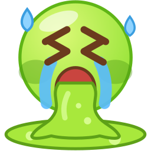

# Open Emoji Cute

**English** | [简体中文](README_cn.md)

A set of cute, oversized emoji.

## The emoji

|                  Preview                  | File                 |                 Preview                 | File                |
| :---------------------------------------: | -------------------- | :-------------------------------------: | ------------------- |
|                    | `smile.svg`          |                      | `sad.svg`           |
|                    | `laugh.svg`          |              | `wronged.svg`       |
|            | `laugh-cry.svg`      |              | `pitiful.svg`       |
|                  | `tongue.svg`         |            | `downcast.svg`      |
|                | `playful.svg`        |          | `exhausted.svg`     |
|            | `delighted.svg`      |                  | `angry.svg`         |
|    | `stifled-laugh.svg`  |              | `furious.svg`       |
|                    | `angel.svg`          |              | `cursing.svg`       |
|                    | `devil.svg`          |              | `annoyed.svg`       |
|              | `blissful.svg`       |          | `terrified.svg`     |
|  | `expressionless.svg` |                  | `vomit.svg`         |
|                | `disdain.svg`        |            | `eye-roll.svg`      |
|                | `stunned.svg`        |              | `puzzled.svg`       |
|              | `thinking.svg`       |  | `awkward-laugh.svg` |
|                      | `huff.svg`           |                                         |                     |

## Usage

Reference as an image:

```html

```

Or inline the SVG markup directly into your page, which lets you control size, filters, and animation with CSS.

Every SVG uses `viewBox="0 0 100 100"` with a default `width`/`height` of 256, and scales without loss. Naming: lowercase English, words joined by hyphens.

## License

Licensed under Apache-2.0
