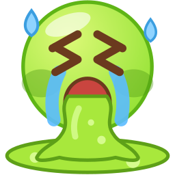

# Open Emoji Cute

[English](README.md) | **简体中文**

一组可爱风大号 emoji。

网页: [imrcpan.com/open-emoji-cute](https://imrcpan.com/open-emoji-cute)

## 表情一览

|                   预览                    | 文件                 | 中文     |                  预览                   | 文件                | 中文 |
| :---------------------------------------: | -------------------- | -------- | :-------------------------------------: | ------------------- | ---- |
|                    | `smile.svg`          | 微笑     |                      | `sad.svg`           | 难过 |
|                    | `laugh.svg`          | 大笑     |              | `wronged.svg`       | 委屈 |
|            | `laugh-cry.svg`      | 笑哭     |              | `pitiful.svg`       | 可怜 |
|                  | `tongue.svg`         | 吐舌     |            | `downcast.svg`      | 失落 |
|                | `playful.svg`        | 调皮     |          | `exhausted.svg`     | 心累 |
|            | `delighted.svg`      | 惊喜     |                  | `angry.svg`         | 生气 |
|    | `stifled-laugh.svg`  | 憋笑     |              | `furious.svg`       | 暴怒 |
|                    | `angel.svg`          | 天使     |              | `cursing.svg`       | 咒骂 |
|                    | `devil.svg`          | 坏笑     |              | `annoyed.svg`       | 不爽 |
|              | `blissful.svg`       | 陶醉     |          | `terrified.svg`     | 惊恐 |
|  | `expressionless.svg` | 面无表情 |                  | `vomit.svg`         | 恶心 |
|                | `disdain.svg`        | 嫌弃     |            | `eye-roll.svg`      | 白眼 |
|                | `stunned.svg`        | 呆住     |              | `puzzled.svg`       | 疑惑 |
|              | `thinking.svg`       | 思考     |  | `awkward-laugh.svg` | 尬笑 |
|                      | `huff.svg`           | 哼       |                                         |                     |      |

## 使用

作为图片引用：

```html

```

或者直接把 SVG 文件内容内联到页面里，这样可以用 CSS 控制它的大小、滤镜和动画。

每个 SVG 的画布是 `viewBox="0 0 100 100"`，默认 `width`/`height` 为 256，缩放不失真。命名规则：英文小写，多个单词用连字符连接。

## 许可

本项目以 Apache-2.0 许可发布。
